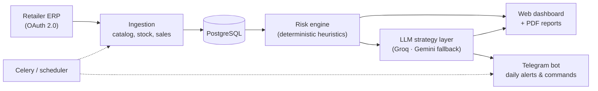
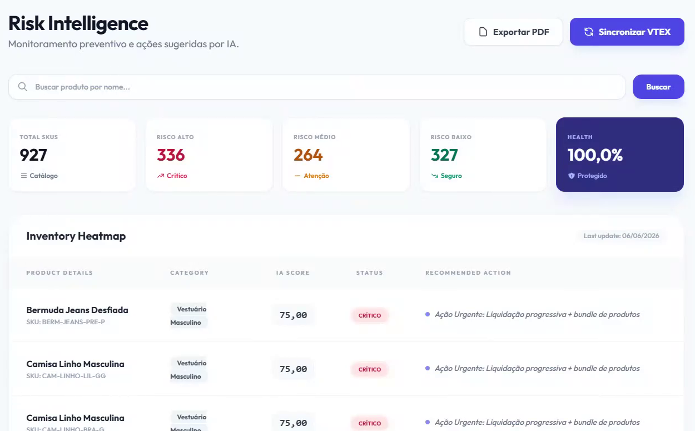
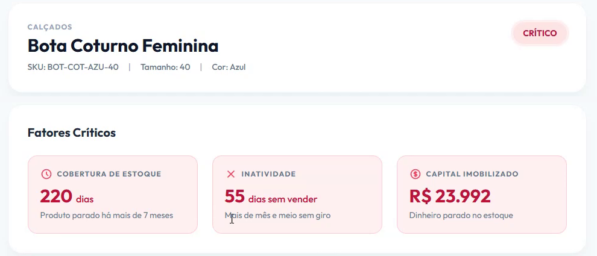
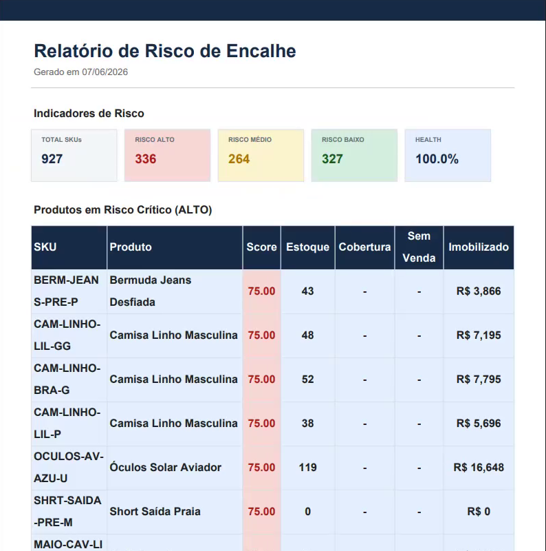

# GirahAI — AI Inventory-Risk Assistant for Fashion E-commerce

> 🔒 **Source code is private** (commercial product). This repository is a public showcase of the problem, the approach and the results.
> Screenshots use **synthetic demo data** — no client data is shown.

Postgraduate capstone project — Intelligent Systems and Agents, Federal University of Goiás (UFG).
Deployed for a pilot retail client.

---

## The problem

Fashion retailers work with seasonal collections, many sizes and colors per product, and small teams.
Products that stop selling (**slow-moving / dead stock**) tie up working capital and shelf space, and are usually noticed too late — when the only option left is a deep discount that destroys the margin.

## What GirahAI does

- **Monitors the whole catalog at variant level** (product × size × color), synced from the retailer's ERP
- **Flags inventory at risk** before it becomes dead stock, with a clear risk level (high / medium / low)
- **Explains why** each item is at risk — stock coverage, days without sales and capital tied up
- **Suggests an action** for each item (e.g. progressive markdown, bundles, campaign copy and coupons), generated by an LLM from the item's context
- **Delivers it where the retailer already is**: daily alerts and on-demand reports via a Telegram bot, plus a web dashboard and PDF reports

## Approach (high level)

A **hybrid design**: deterministic risk heuristics decide *what* is at risk; an LLM helps decide *what to do about it*.

- The risk engine is rule-based and auditable — every score can be traced back to the inventory facts that produced it
- The LLM layer turns the risk context into concrete, plain-language recommendations for non-technical users
- When no LLM is available, the system **clearly labels the output as simulated** instead of presenting it as AI-generated

## Architecture

## Screenshots

**Risk dashboard** — catalog overview and items ranked by risk

**Risk detail** — the critical factors behind an item's risk

**PDF report** — shareable summary of items at high risk

## Engineering highlights

- **Provider-agnostic LLM client** — Groq as primary, automatic fallback to Gemini; transparent "simulated" mode when no provider responds
- **Security** — ERP OAuth tokens encrypted at rest (Fernet); secrets kept out of logs; guardrails against prompt injection
- **Privacy** — LGPD-oriented audit of personal data
- **Safety nets** — guards against destructive data operations on the production database
- **Quality** — 130+ automated tests

## Tech stack

Python · Django · Django Ninja · Celery · Redis · PostgreSQL · Docker · Groq / Gemini APIs · Telegram Bot API · Linux VPS

---

**Author:** [Alainy Rocha](https://www.linkedin.com/in/alainyrocha/) · [GitHub](https://github.com/alainy-rocha-dev)
Demo available on request.
